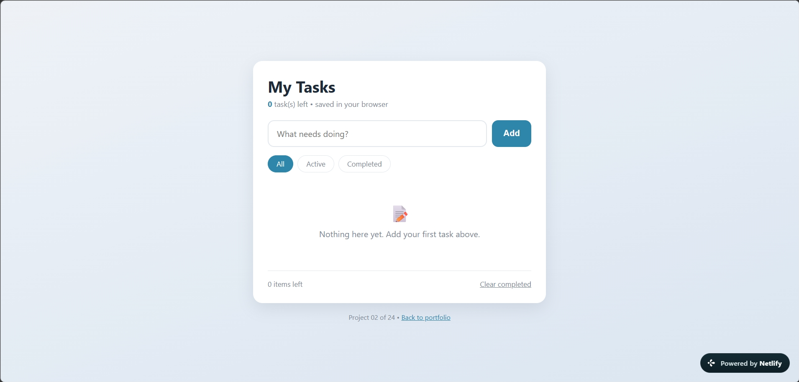

# To-Do App — Project #02

[Live Demo](https://keaton-todo.netlify.app) | [GitHub Repo](https://github.com/Keatonpillay23/todo-project-2)



## What I Built
A fully functional to-do app in vanilla JavaScript — Project 2 of my 12-week, 24-project Full-Stack journey. No frameworks, no libraries, no backend. Tasks persist in `localStorage`, so they survive a page refresh.

## Features
- ➕ Add tasks (click **Add** or press **Enter**)
- ✅ Mark tasks complete with a checkbox
- ✏️ Edit a task by **double-clicking** its text
- 🗑️ Delete individual tasks
- 🔍 Filter by **All / Active / Completed**
- 🧹 Clear all completed tasks at once
- 💾 Tasks saved to `localStorage` — still there after refresh or browser restart
- 🛡️ HTML-escaped output to prevent script injection (XSS)
- 📱 Responsive, keyboard-friendly

## Tech Stack


## Run Locally
```bash
git clone https://github.com/Keatonpillay23/todo-project-2.git
cd todo-project-2
```
Open `index.html` in your browser, or use VS Code's Live Server. No build step.

## How It Works
The whole app is one array of objects:
```js
todos = [
  { id: 1732091234567, text: 'Buy milk', completed: false }
]
```
Every interaction changes that array, saves it to `localStorage`, then re-renders the list from it. The UI is a picture of the data — no manual DOM fiddling.

## What I Learned
- Arrays of objects as application state
- `.map()`, `.filter()`, `.find()` for transforming data
- `localStorage` + `JSON.stringify()` / `JSON.parse()`
- Event delegation: one listener on the `<ul>` instead of one per task
- `data-*` attributes to carry IDs in the DOM
- Escaping user input to prevent XSS
- State-driven rendering (the mental model behind React)

## What I'd Improve Next
- Drag-and-drop reordering
- Due dates and priority levels
- Categories / tags
- Rebuild it in React (Week 3) to compare approaches

## Deployment
Deployed on Netlify via GitHub import. Every push to `main` redeploys automatically.
